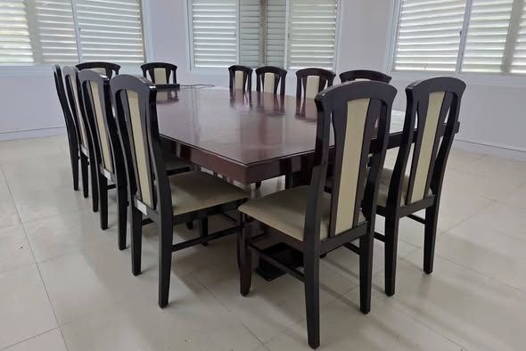
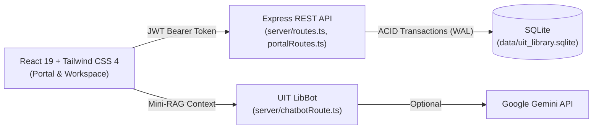

<div align="center">
  

  <h1>HỆ THỐNG QUẢN LÝ &amp; CỔNG THÔNG TIN THƯ VIỆN UIT</h1>

  <p>
    <strong>Đồ án môn học SE104.R11 – Nhập môn Công nghệ phần mềm</strong><br/>
    Trường Đại học Công nghệ Thông tin – Đại học Quốc gia TP. Hồ Chí Minh (UIT – ĐHQG-HCM)<br/>
    <em>Toà nhà A, Khu phố 34, Phường Linh Xuân, TP. Hồ Chí Minh</em>
  </p>

  <p>
    
    
    
    
    
  </p>

  <p>
    <a href="#1-thông-tin-chung">Thông tin đồ án</a> •
    <a href="#2-tính-năng--phân-quyền-hệ-thống">Tính năng &amp; Phân quyền</a> •
    <a href="#3-kiến-trúc--công-nghệ">Kiến trúc</a> •
    <a href="#4-cấu-trúc-thư-mục">Cấu trúc thư mục</a> •
    <a href="#5-cài-đặt--khởi-chạy">Cài đặt &amp; Kiểm thử</a>
  </p>
</div>

---

<div align="center">
  <table>
    <tr>
      <td align="center" width="50%">
        <br/>
        <sub><strong>Cổng tra cứu &amp; Khám phá tri thức UIT</strong></sub>
      </td>
      <td align="center" width="50%">
        <br/>
        <sub><strong>Không gian đọc tại chỗ &amp; kho mở Tầng 2</strong></sub>
      </td>
    </tr>
    <tr>
      <td align="center" width="50%">
        <br/>
        <sub><strong>Khu vực tự học tự do Tầng trệt</strong></sub>
      </td>
      <td align="center" width="50%">
        <br/>
        <sub><strong>Phòng học nhóm A2.01 – Đặt lịch trực tuyến</strong></sub>
      </td>
    </tr>
  </table>
</div>

---

## 1. Thông tin chung

| Hạng mục | Nội dung |
| :--- | :--- |
| **Đề tài** | Hệ thống Quản lý &amp; Cổng thông tin Thư viện UIT |
| **Môn học** | SE104.R11 – Nhập môn Công nghệ phần mềm (4 tín chỉ: 3 LT · 1 TH) |
| **Môn học trước** | IT002, IT004 (Hệ số điểm: Quá trình `0.3` · Đồ án `0.7`) |
| **Giảng viên hướng dẫn** | **TS. Đỗ Thị Thanh Tuyền** |
| **Đơn vị thực tế tham chiếu** | Phòng Đảm bảo chất lượng, Thư viện và Pháp chế – UIT |

### Thành viên thực hiện (Nhóm 19)

| STT | Họ và tên | MSSV |
| :---: | :--- | :---: |
| 1 | **Lâm Chí Dĩnh** | `23520291` |
| 2 | **Nguyễn Lê Bảo Đăng** | `23520230` |
| 3 | **Nguyễn Hoàng Lộc** | `23520858` |
| 4 | **Nguyễn Thị Minh Thư** | `23521543` |
| 5 | **Nguyễn Trường Vũ** | `23521812` |

---

## 2. Tính năng &amp; Phân quyền hệ thống

Hệ thống kết hợp **Cổng bạn đọc công khai (Public Portal)** và **Không gian làm việc phân quyền (Workspace)** đồng bộ dữ liệu trực tiếp qua REST API &amp; SQLite.

### Phân quyền theo tác nhân (RBAC)

| Vai trò | Quyền hạn &amp; Chức năng chính |
| :--- | :--- |
| **Khách / Bạn đọc vô danh** | Tra cứu hơn **1.085 học liệu** không dấu (`Ctrl+K`), lọc theo 12 ngành UIT, dùng **Search Engine Bản đồ Tri thức**, đặt phòng họp nhóm **A2.01 / A2.02**, gửi đề xuất bổ sung tài liệu, xem giờ mở cửa realtime và hỏi **UIT LibBot**. |
| **Sinh viên / Độc giả (`READER`)** | Toàn bộ quyền khách ngay trong không gian cá nhân + **Đổi mật khẩu tài khoản**, đặt trước / giữ chỗ sách, theo dõi thẻ, gia hạn sách trực tuyến (tối đa 2 lần), xem lịch sử trả và công nợ tiền phạt. |
| **Chuyên viên thư viện (`LIBRARIAN`)** | Tiếp nhận & cập nhật sách, thêm tác giả, quản lý hồ sơ độc giả & gia hạn thẻ, lập phiếu mượn – nhận trả (tự giữ chỗ cho người đặt trước), thu tiền phạt, xử lý yêu cầu sách & lịch đặt phòng, xem báo cáo BM7.1/BM7.2. |
| **Phụ trách thư viện (`HEAD_LIBRARIAN`)** | Toàn bộ quyền Chuyên viên + **Xóa sách, sửa/xóa tác giả**, đăng/sửa/xóa **Tin tức & Sự kiện Portal**, tạo/sửa/khóa tài khoản cấp `LIBRARIAN` & `READER`, chỉnh sửa quy định/thể loại và xem nhật ký thao tác (`NHATKYTHAOTAC`). |
| **Quản trị viên (`ADMIN`)** | Toàn quyền hệ thống: quản lý tài khoản mọi cấp (kể cả `ADMIN` & `HEAD_LIBRARIAN`), cấu hình quy định, tin tức Portal, nhật ký bảo mật và **sao lưu/khôi phục dữ liệu SQLite/JSON**. |

### Điểm nổi bật về giao diện &amp; nghiệp vụ

- **Cổng thông tin &amp; Dashboard đa phân quyền:** Bố cục rộng `1280px`, nền **Ambient Mesh Glow &amp; Dot-Grid**, Hero Banner theo từng vai trò (`ADMIN`, `HEAD_LIBRARIAN`, `LIBRARIAN`, `READER`, Khách), hỗ trợ Light/Dark mode và responsive trên mọi kích thước màn hình.
- **Kho học liệu UIT thực tế (1.085+ tài liệu):**
  - **115/115 giáo trình UIT** kèm **115 ảnh bìa thật**, vị trí kệ, link OPAC và bản điện tử `ir.vnulib.edu.vn`.
  - **912 luận văn UIT (2004–2026)** trình bày dạng bìa cứng gáy vàng **phân màu theo 12 ngành đào tạo**.
  - **58 đầu sách chuyên ngành, ngoại văn, Tủ sách Học tập suốt đời &amp; OpenStax OER**; sách chưa có ảnh hiển thị **bìa 3D tượng trưng** theo ngành.
- **Bản đồ Tri thức có Search Engine:** Tích hợp tìm kiếm không dấu &amp; gợi ý tài liệu liên quan cùng ngành/tác giả trên đồ thị 2D (`react-force-graph-2d`), phân cấp kích thước và màu sắc theo 4 nhóm nút (*Ngành UIT*, *Thể loại*, *Sách/Luận văn*, *Tác giả*).
- **Trạng thái mở cửa Realtime &amp; UIT LibBot:** Tự động tính giờ mở cửa theo múi giờ Việt Nam (`T2–T6: 07:30–18:00`, `T7: 08:00–16:00`), kết hợp Gemini API (`gemini-2.5-flash`) và Local Smart Engine.

---

## 3. Kiến trúc &amp; Công nghệ



| Tầng | Công nghệ sử dụng |
| :--- | :--- |
| **Frontend** | React 19, TypeScript, Tailwind CSS 4, Radix UI, Lucide Icons, Sonner |
| **Trực quan hóa** | Recharts (biểu đồ lưu thông &amp; báo cáo), React Force Graph 2D (Bản đồ tri thức) |
| **Bảng &amp; Validation** | TanStack React Table, Zod |
| **Backend &amp; DB** | Express 4, Better-SQLite3 (WAL mode), `jsonwebtoken`, `bcryptjs` |
| **AI &amp; Build** | `@google/genai`, Vite 8, `tsx`, `node:test` |

---

## 4. Cấu trúc thư mục

```text
├── server.ts                  # Điểm khởi chạy Express + Vite middleware
├── server/
│   ├── auth.ts                # Xác thực JWT & middleware phân quyền RBAC 4 vai trò
│   ├── db.ts                  # Kết nối SQLite WAL, schema & seed cốt lõi
│   ├── migratePortal.ts       # Migration & đồng bộ 1.085+ học liệu, ngành, tin tức, phòng họp
│   ├── routes/                # API tách module (auth, catalog, reader, circulation, admin)
│   ├── portalRoutes.ts        # API portal-bundle, tin tức CRUD, đặt trước, đặt phòng, gia hạn
│   └── chatbotRoute.ts        # Endpoint UIT LibBot (/api/chatbot/ask)
├── public/
│   ├── images/                # Logo chính thức Thư viện UIT
│   └── resources/             # 115 ảnh bìa giáo trình, bìa sách, 12 ngành, sự kiện & phòng A2.01–A2.02
├── data/
│   └── uit_library.sqlite     # Cơ sở dữ liệu SQLite cục bộ (full Portal + Workspace)
├── tests/
│   └── rbac-and-sync.test.ts  # Bộ test End-to-End phân quyền 4 vai trò & đồng bộ CSDL
└── src/
    ├── features/
    │   ├── portal/            # Trang chủ, Tra cứu, 12 Ngành học, Bản đồ tri thức (Search), Dịch vụ, Giới thiệu
    │   ├── workspace/         # Dashboard theo vai trò, Cổng Sinh viên, Đổi mật khẩu, Sách/Tác giả, Tin tức, Quản trị
    │   └── chatbot/           # UIT LibBot widget & Local Smart Engine
    ├── services/              # Tầng giao tiếp REST API (apiClient.ts & domain services)
    ├── database/              # Dữ liệu tham chiếu (seedTextbooks, seedTheses, seedBooksExtra, ...)
    ├── components/ui/         # Thành phần UI dùng chung (Button, Card, ThemeToggle, LiveLibraryHours)
    └── lib/                   # Tiện ích, hash router & quy tắc nghiệp vụ thuần
```

---

## 5. Cài đặt &amp; Khởi chạy

### Yêu cầu môi trường

- **Node.js** `>= 20`
- **npm**

### Bước 1: Cài đặt &amp; Cấu hình

```bash
# Cài đặt các gói phụ thuộc
npm install --legacy-peer-deps

# (Tùy chọn) Tạo file .env nếu muốn kích hoạt Gemini AI cho chatbot & cố định JWT secret
cp .env.example .env
```

Các biến môi trường hỗ trợ trong `.env`:
- `PORT`: Cổng chạy server (mặc định `3000`).
- `JWT_SECRET`: Chuỗi bí mật ký JWT (`>= 16` ký tự).
- `GEMINI_API_KEY`: API key Google Gemini (nếu bỏ trống, UIT LibBot tự dùng Local Smart Engine).

### Bước 2: Khởi chạy ứng dụng

```bash
# Chạy đồng thời Backend Express + Frontend Vite tại http://localhost:3000
npm run dev
```

> Trong giao diện **Đăng nhập**, bạn có thể chọn đăng nhập nhanh theo **4 vai trò trải nghiệm**: **Admin (`ADMIN`)**, **Phụ trách TV (`HEAD_LIBRARIAN`)**, **Chuyên viên TV (`LIBRARIAN`)** hoặc **Sinh viên (`READER`)**.

### Bước 3: Kiểm tra &amp; Đóng gói

```bash
# Kiểm tra kiểu tĩnh TypeScript
npm run lint

# Đóng gói bản production (thư mục dist/)
npm run build

# Chạy bộ kiểm thử End-to-End phân quyền 4 vai trò, đổi mật khẩu & đồng bộ SQLite
npm test

# Chạy kiểm thử đơn vị quy tắc nghiệp vụ & chatbot
npx tsx --test src/lib/businessRules.test.ts src/features/chatbot/libBotEngine.test.ts
```
